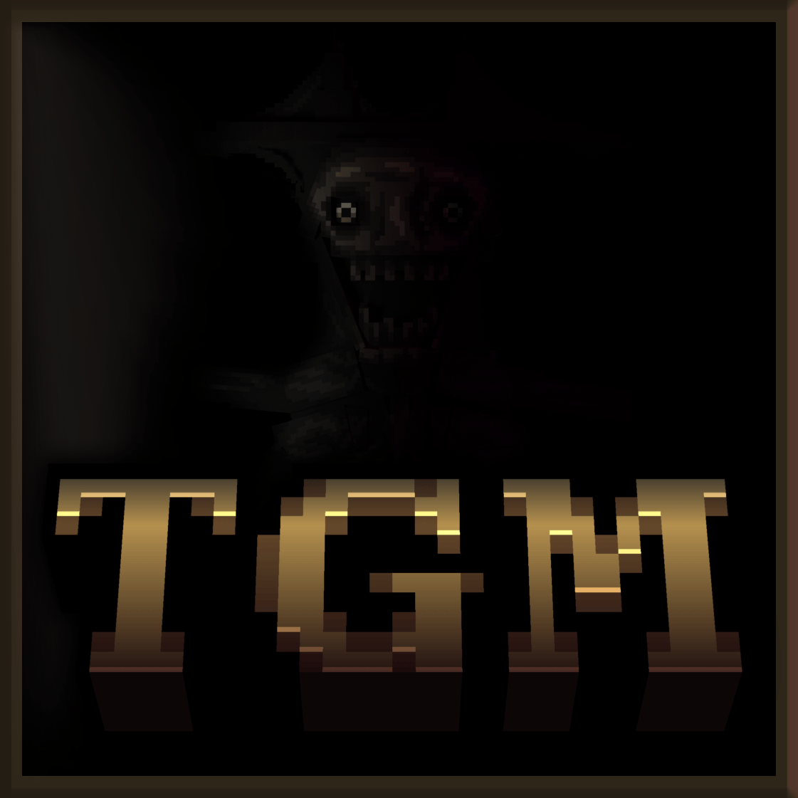
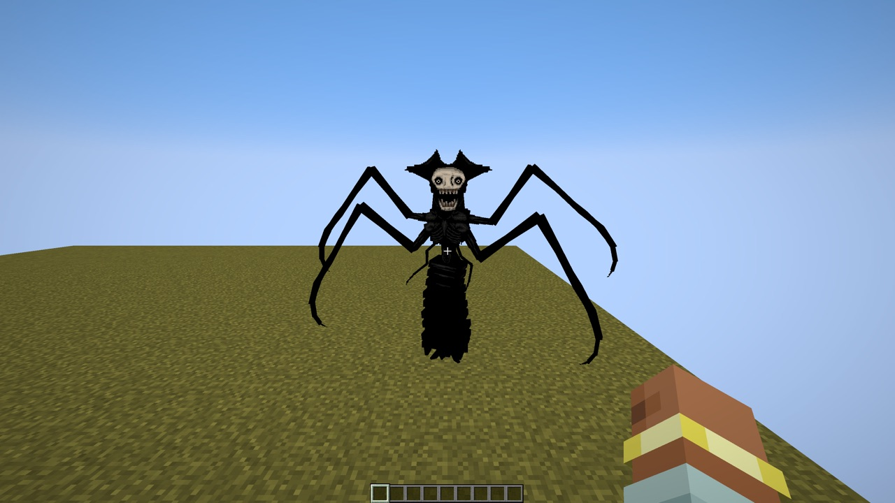
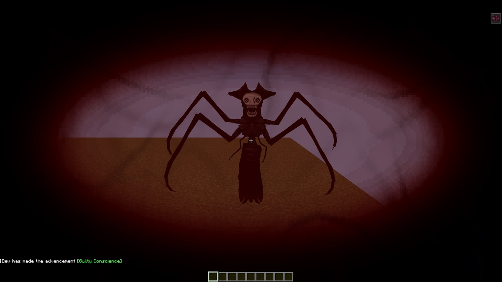

# The Growling Man — NeoForge + Fabric 26.3

**He stalks you, and he is drawn to sorrow and grief.**

An unofficial port of **[The Growling Man](https://www.curseforge.com/minecraft/mc-mods/the-growling-man)** 1.0.1
by **Voxla** (directed by Lord0wnage, creature by Bonesworth) from Forge 1.20.1 to **NeoForge and Fabric 26.3**.

<b>🇬🇧 English — click to open</b>

## About

A horror mod: the Growling Man stalks you through your world, watches you from caves and the dark, hides when you look
at him, and appears when you check your inventory. He comes for players who are "marked" — who caused sorrow, such as
killing many animals quickly — and goes on a rampage during raids. When he stares at you, clear your mind (the key,
**X** by default), but not too early, or you have a mental breakdown.

## Installation

**NeoForge**
1. Install **NeoForge 26.3.0.97** or newer for Minecraft **26.3**.
2. Put **[GeckoLib](https://modrinth.com/mod/geckolib)** (5.5.7 or newer, NeoForge 26.3) into `mods`.
3. Put `the-growling-man-neoforge-1.0.1.1+26.1.2.jar` from the [releases](../../releases) into `mods`.

**Fabric**
1. Install **Fabric Loader 0.19.5** or newer for Minecraft **26.3** and **[Fabric API](https://modrinth.com/mod/fabric-api)**.
2. Put **[GeckoLib](https://modrinth.com/mod/geckolib)** (5.5.7 or newer, Fabric 26.3) into `mods`.
3. Put `the-growling-man-fabric-1.0.1.1+26.1.2.jar` from the [releases](../../releases) into `mods`.

Needed on both the client and the server. The music and jumpscare sounds use the "Jukebox/Note Blocks" volume.

## Config

`config/growling_man_config.toml`, the same file as in 1.0.1: spawn time min / max (seconds), spawn chance, chase time
min / max (minutes), regenerate broken blocks, no spawning on the first day, max spawn distance, quick animal kills
needed to get marked. On NeoForge the [Configured](https://www.curseforge.com/minecraft/mc-mods/configured) mod edits it
in game; on both loaders a changed file is read again while the game runs.

## What changed in the port

The content and the behaviour are the same as in 1.0.1. Details: [PORTLOG.md](PORTLOG.md).

- **Dedicated servers work.** 1.0.1 crashed a dedicated server as soon as a player was ticked (the server read the
  client's screen), and in LAN worlds it checked every player against the host's inventory.
- **The timers follow the config.** In 1.0.1 the spawn timer ran once per dimension per tick, so he came three times
  as often as the configured seconds. For the old pace, set the spawn times to a third (20 / 80).
- **Less lag.** The check whether a player sees him cast 480 rays per player per tick (now one); searches for players
  in boxes up to 600 blocks use the player list; the variables are synced once per tick instead of after every change
  (220 → 40 packets per second). The Growling Man's own tick: 579 → 179 µs on the server, 479 → 76 µs on the client.
- **Fabric** is new in the port.

## License and credits

[LGPL-3.0-only](LICENSE). The original mod is MIT-licensed: its text and copyright are in
[licenses/LICENSE-MIT](licenses/LICENSE-MIT). The Growling Man, its art, model, animations and sounds: **Voxla**,
**Lord0wnage** and **Bonesworth** (made with MCreator). Port to NeoForge and Fabric: Vladeezyy. Please download the port
only from its official pages.

<b>🇷🇺 Русский — нажмите, чтобы открыть</b>

## О моде

Хоррор-мод: Growling Man преследует вас по миру, наблюдает из пещер и темноты, прячется, когда на него смотрят, и
появляется, когда вы открываете инвентарь. Он приходит за «отмеченными» игроками — теми, кто принёс горе, например
быстро убил много животных, — а во время рейдов впадает в ярость. Когда он смотрит на вас, очистите разум (клавиша,
по умолчанию **X**), но не слишком рано, иначе случится нервный срыв.

## Установка

**NeoForge**
1. Установите **NeoForge 26.3.0.97** или новее для Minecraft **26.3**.
2. Положите в `mods` **[GeckoLib](https://modrinth.com/mod/geckolib)** (5.5.7 или новее, NeoForge 26.3).
3. Положите в `mods` `the-growling-man-neoforge-1.0.1.1+26.1.2.jar` из [релизов](../../releases).

**Fabric**
1. Установите **Fabric Loader 0.19.5** или новее для Minecraft **26.3** и **[Fabric API](https://modrinth.com/mod/fabric-api)**.
2. Положите в `mods` **[GeckoLib](https://modrinth.com/mod/geckolib)** (5.5.7 или новее, Fabric 26.3).
3. Положите в `mods` `the-growling-man-fabric-1.0.1.1+26.1.2.jar` из [релизов](../../releases).

Нужен и на клиенте, и на сервере. Громкость музыки и скримеров — ползунок «Музыкальные блоки».

## Настройки

`config/growling_man_config.toml`, тот же файл, что в 1.0.1: время спавна (секунды), шанс спавна, время погони
(минуты), восстановление сломанных блоков, без спавна в первый день, дальность спавна, число быстрых убийств животных
для отметки. На NeoForge файл правится в игре модом [Configured](https://www.curseforge.com/minecraft/mc-mods/configured);
на обоих загрузчиках изменённый файл перечитывается на ходу.

## Что изменилось в порте

Содержимое и поведение те же, что в 1.0.1. Подробно: [PORTLOG.md](PORTLOG.md).

- **Работают выделенные серверы.** 1.0.1 ронял выделенный сервер при первом же тике игрока (сервер читал экран
  клиента), а в LAN проверял инвентарь хоста вместо инвентаря каждого игрока.
- **Таймеры соответствуют настройкам.** В 1.0.1 таймер спавна шёл в каждом измерении, и Growling Man приходил втрое
  чаще заданных секунд. Чтобы вернуть старый темп, уменьшите время спавна втрое (20 / 80).
- **Меньше лагов.** Проверка «видит ли игрок Growling Man» делала 480 трассировок на игрока за тик (теперь одну); поиск
  игроков в кубах до 600 блоков идёт по списку игроков; переменные синхронизируются раз за тик, а не после каждого
  изменения (220 → 40 пакетов в секунду). Тик самого Growling Man: 579 → 179 мкс на сервере, 479 → 76 мкс на клиенте.
- **Fabric** — новое в порте.

## Лицензия и авторы

[LGPL-3.0-only](LICENSE). Оригинальный мод под MIT: текст лицензии и копирайт — в
[licenses/LICENSE-MIT](licenses/LICENSE-MIT). Growling Man, его графика, модель, анимации и звуки: **Voxla**,
**Lord0wnage** и **Bonesworth** (сделано в MCreator). Порт на NeoForge и Fabric: Vladeezyy. Скачивайте порт только с его
официальных страниц.

